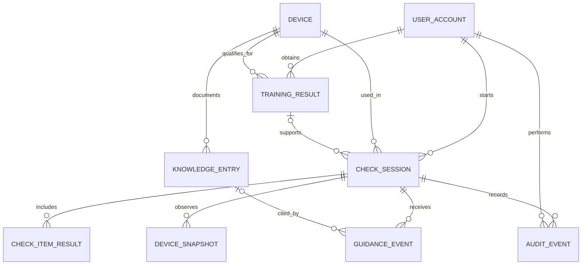

# LabMate 数据库设计说明书
啊对对队｜第二次团队作业｜v0.1 评审稿｜2026-11-06

## 1 引言与设计原则
参照 GB/T 8567-2006《计算机软件文档编制规范》的组织思路。本文覆盖准入、检查、指导、现场复核和审计。使用关系型数据库；开发候选为 PostgreSQL，当前不建生产库。ER 指实体关系；PK 为主键，FK 为外键，UQ 为唯一约束。时间统一以带时区时间存储，界面按本地时区显示。

## 2 实体关系

## 3 关系模型与对象映射
实体类和表按下列顺序一一对应。各表 ID 为应用生成的通用唯一标识符（UUID）；除注明可空的字段外均必填。业务库保存模型提示摘要和身份核验结果；原始素材在对应流程中临时处理。
| 实体 / 表 | 关键字段与约束 |
|---|---|
| UserAccount / user_account | id PK；login UQ；role ∈ USER, ADMIN；experience ∈ NOVICE, EXPERIENCED；active。 |
| Device / device | id PK；asset_code UQ；model；training_version；checklist_version；enabled。 |
| TrainingResult / training_result | id PK；user_id FK；device_id FK；version；outcome；assessed_at；valid_until 可空；revoked_at 可空。保留历次记录。 |
| CheckSession / check_session | id PK；user_id FK；device_id FK；training_result_id FK 可空；identity_result；mode ∈ SIMULATED, REAL；状态；checklist_version；created_at；expires_at；submit_key 可空 UQ。 |
| CheckItemResult / check_item_result | id PK；session_id FK；item_code；source；result；checked_at；UQ(session_id,item_code)。 |
| DeviceSnapshot / device_snapshot | id PK；session_id FK；mode ∈ SIMULATED, REAL；state；observed_at；valid_until；error_code 可空。 |
| KnowledgeEntry / knowledge_entry | id PK；device_id FK；item_code；title；source_ref；version；approved；content；UQ(device_id,item_code,source_ref,version)。 |
| GuidanceEvent / guidance_event | id PK；session_id FK；entry_id FK 可空；item_code；summary；outcome；created_at。 |
| AuditEvent / audit_event | id PK；session_id FK；actor_id FK；action；reason_code；created_at；note 可空。 |

## 4 数据读写与一致性
准入时按用户、设备、当前培训版本查询最近一次考核结果，并核对是否通过、过期或撤销；不回退到更早的通过记录；当前结果被撤销或过期后，提交时必须重新判定。进入检查时记录清单版本及对应考核；关联的考核记录须属于同一用户、设备和培训版本。状态适配器写入设备快照，规则读取同会话中来源匹配且最新的有效快照；演示数据和真实数据隔离，状态不可用写明原因。
最终提交锁定会话记录、核对身份和资格有效期、检查项及设备状态，在单个事务内写入最终状态和审计事件。提交键重复时返回已保存结果。现场复核以审计事件记录操作人、关联会话和原因，不直接改写培训记录或设备状态。
建议索引：training_result(user_id,device_id,version,assessed_at)，check_session(device_id,created_at)，device_snapshot(session_id,observed_at)，guidance_event(session_id,created_at)。会话明细可从外键查回；后台列表按时间分页。

## 5 权限、保存与恢复
用户只能读取本人会话；管理端按设备管理权限查看记录和追加复核事件。身份核验只保存结果；视觉只保存必要的提示摘要和依据引用。资料须经批准后可检索，版本更新保留可追溯引用。保留期、备份频率和删除责任由协会在上线前确定。演示库可单独重置；实际部署前应验证备份恢复和删除流程。

## 6 设计检查
拟验收场景：未培训时会话保持 LOCKED；设备状态过期时提示刷新；同一提交键返回同一结果；复核记录保存操作人；真实会话只读取真实快照。
