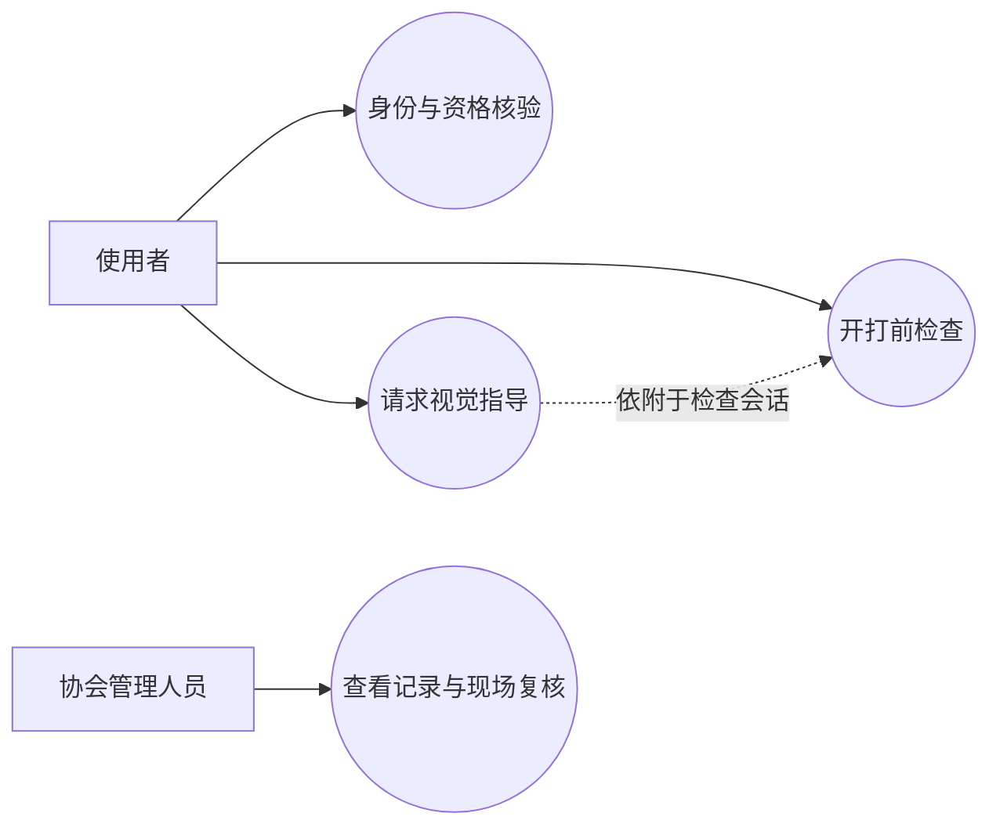
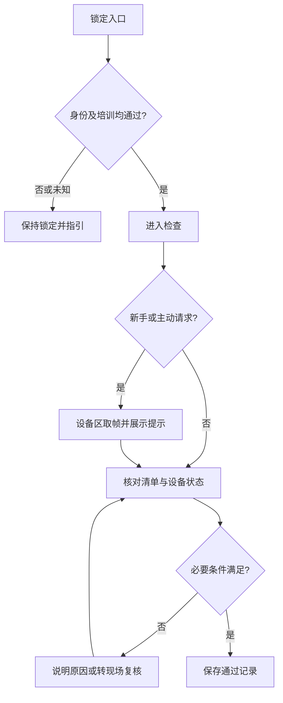
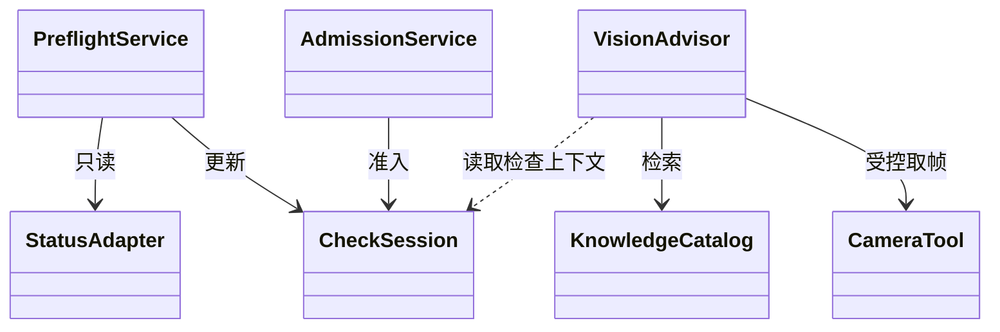
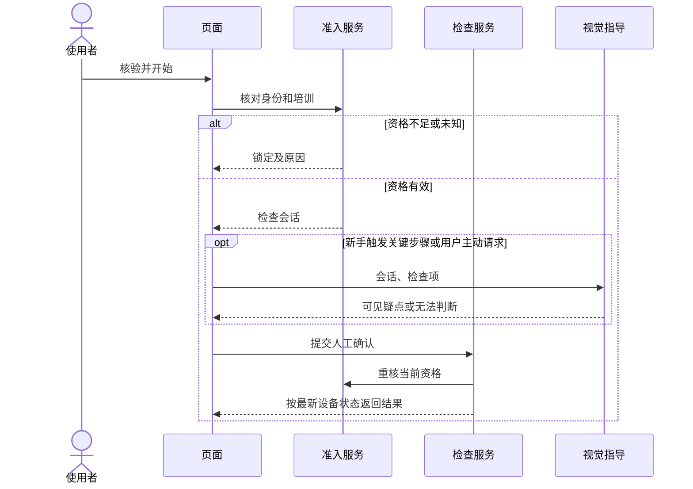
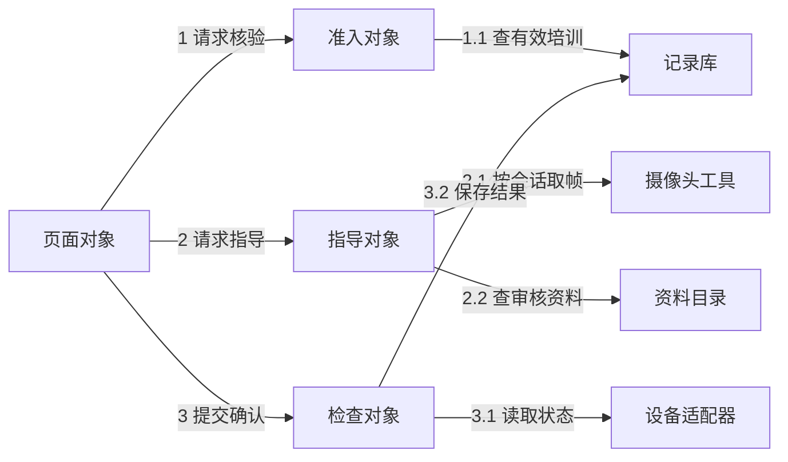

# LabMate 系统设计说明书
啊对对队｜第二次团队作业｜v0.1 评审稿｜2026-11-06

## 1 引言与范围
本文用于原型和概要设计评审，参照 GB/T 8567-2006《计算机软件文档编制规范》的组织思路。需求来源是第一次团队作业中对协会管理人员和初学使用者的交流，以及答辩后的范围收敛。现阶段没有真机联调或模型效果结论。
目标是降低未培训和漏做准备检查造成的误操作风险。仅覆盖创客中心一台拓竹 H2D，从身份核验到开打前检查记录。设备实际操作仍走协会流程。本期不做远程启停、运行中断电、持续监控、多设备接入或门禁联动。
术语：UML 为统一建模语言；MCP 为模型上下文协议；LLM 为大语言模型。资格放行仅指进入 LabMate 检查流程；检查通过仅表示软件内约定条件已满足。

## 2 用例与分层
新手或熟练用户发起身份核验、查看培训状态、完成清单、请求指导；协会管理人员复核需要现场确认的记录并查看检查结果。角色与熟练度分开，熟练用户仍须接受身份及培训校验。培训以协会现行学习和考核记录为准，首版不制作完整线上课程。
表现层提供使用者页面和管理后台。应用层编排身份校验、资格查询、检查会话和指导请求。领域层用确定性规则判断状态；数据和适配层提供记录库、协会认可资料、身份核验适配器、H2D 只读状态适配器与 MCP 摄像头工具。模型只解释情况和返回可见疑点。

## 3 主流程与异常
会话初始为 LOCKED。身份成功且当前适用培训版本通过后进入 CHECKING；任何资格缺失或查询失败保持锁定。清单包含用户现场确认项和设备可读项。设备状态缺失、过期或忙碌时不得通过；人工项未确认也不得通过。系统记录阻塞原因，并允许重试。提交前重新核对资格和设备状态，成功转为 PASSED；失效会话须重新核验。
摄像头不可用或模型无法判断时，视觉状态显示“无法判断”，需要时走协会指定的现场确认。复核记录必须有管理员身份和理由，且不能覆盖培训校验失败、设备忙碌或未知状态。相同提交键重复请求返回原结果。

## 4 类图与模块职责

AdmissionService 决定能否进入检查。PreflightService 持有检查状态并独立计算结果。VisionAdvisor 读取会话及批准的资料，返回解释与建议。CameraTool 仅允许指定会话的设备区画面；StatusAdapter 只提供状态、采集时间和有效性。KnowledgeCatalog 按设备、检查项和资料版本筛选协会审核内容。

## 5 时序与协作

## 6 接口、安全与模型
拟定接口：POST /admissions 核验并返回状态与原因；GET /sessions/{id} 读取本人会话；POST /sessions/{id}/guidance 仅允许有效会话和检查项；POST /sessions/{id}/submit 提交人工确认；管理端读取记录及提交现场复核。客户端不能指定自己的培训结果、熟练度或通过状态。
人脸核验通道与设备画面隔离，业务库只保留核验结果和引用；原型不采集人脸。设备帧默认临时处理，不入业务库。按会话限流、限定设备和设备区。新手仅在关键项短时多帧，熟练用户默认不主动触发；帧数和超时上线前确定。设备状态接口存在已由团队确认，字段、时效及授权待核对。
模型输入限当前检查项、审核资料及设备区画面。输出为可见疑点、依据、下一步及无法判断标识。资料和画面内文字只是数据；模型不能解锁、通过检查或操控设备。工具失败和资料不足时回到人工渠道。

## 7 后续验收
用同一套虚拟设备数据走查：未培训锁定；新手关键步骤出现提示；熟练用户不自动弹出提示；摄像头不可用走复核且无视觉通过；状态未知或过期不能提交通过。对比通用模型与本系统在同一模拟场景中是否能结合当前检查项、设备状态和协会资料指出下一步。开发后另验证真实接口可读性、权限和隐私流程，现阶段无测试结果。
