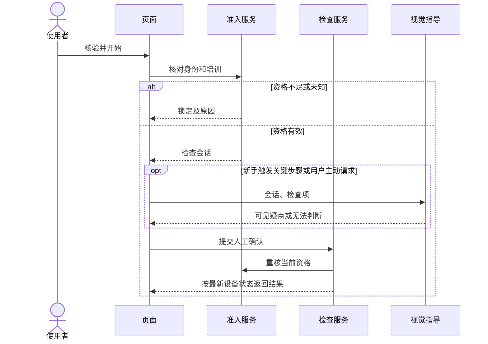

# 林诗航｜准入与检查规则

| 条件 | 预期结果 | 界面下一步 |
|---|---|---|
| 身份未核验或失败 | LOCKED | 重试或找协会管理员 |
| 身份通过，但培训未通过、已过期或查询失败 | LOCKED | 查看学习指引或联系协会 |
| 身份和当前培训均通过 | CHECKING | 打开本次检查清单 |
| 检查期间资格被撤销 | 提交时重新核验，拒绝通过 | 说明资格变化并重新核验 |
| 设备忙、状态未知或过期 | 检查不通过，允许刷新 | 刷新状态或联系协会 |
| 摄像头不可用 | 视觉无法判断 | 需要时由管理员现场复核 |
| 必要条件满足 | PASSED，记录检查结果 | 按现场流程使用设备 |

服务端管理身份、培训与检查结果。重复提交返回已保存结果。提交时若资格变化，后端拒绝写入通过结果，并返回新的阻塞原因。

## 主流程时序图设计

> 本图的可编辑源文件为 [reviews/林诗航/主流程时序图.mmd](林诗航/主流程时序图.mmd)，与下方内嵌图内容一致。

