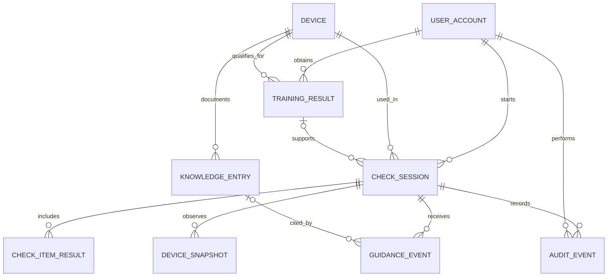

# 谢玲洁｜数据库设计校核

| 校核点 | 建议检查 |
|---|---|
| 资格版本 | 按用户、设备、版本查最近一次考核；过期或撤销时，按当前资格失效处理。 |
| 会话与设备快照 | 快照记录来源及时间；真实会话只读取真实快照。 |
| 检查项 | 同一会话的同一检查项只存一条当前结果。 |
| 管理员复核 | 追加记录操作者和原因；培训资格和设备状态仍由后端独立校验。 |
| 视觉与人脸 | 业务库保存提示摘要、资料引用和核验结果。原始画面在对应流程中临时处理。 |
| ER 与关系模型 | 对照图和表，检查表中标明的外键与基数是否对应。 |

## 2 实体关系

## 3 关系模型与对象映射
实体类和表按下列顺序一一对应。各表 ID 为应用生成的通用唯一标识符（UUID）；除注明可空的字段外均必填。业务库保存模型提示摘要和身份核验结果；原始素材在对应流程中临时处理。
| 实体 / 表 | 关键字段与约束 |
|---|---|
| UserAccount / user_account | id PK；login UQ；role ∈ USER, ADMIN；experience ∈ NOVICE, EXPERIENCED；active。 |
| Device / device | id PK；asset_code UQ；model；training_version；checklist_version；enabled。 |
| TrainingResult / training_result | id PK；user_id FK；device_id FK；version；outcome；assessed_at；valid_until 可空；revoked_at 可空。保留历次记录。 |
| CheckSession / check_session | id PK；user_id FK；device_id FK；training_result_id FK 可空；identity_result；mode ∈ SIMULATED, REAL；状态；checklist_version；created_at；expires_at；submit_key 可空 UQ。 |
| CheckItemResult / check_item_result | id PK；session_id FK；item_code；source；result；checked_at；UQ(session_id,item_code)。 |
| DeviceSnapshot / device_snapshot | id PK；session_id FK；mode ∈ SIMULATED, REAL；state；observed_at；valid_until；error_code 可空。 |
| KnowledgeEntry / knowledge_entry | id PK；device_id FK；item_code；title；source_ref；version；approved；content；UQ(device_id,item_code,source_ref,version)。 |
| GuidanceEvent / guidance_event | id PK；session_id FK；entry_id FK 可空；item_code；summary；outcome；created_at。 |
| AuditEvent / audit_event | id PK；session_id FK；actor_id FK；action；reason_code；created_at；note 可空。 |

## 4 实际核对与修改

2026-11-07 对照仓库 main 的 design/database.md 做静态核对。未运行后端或数据库测试。

- 9 个实体名与关系模型逐一对应。表中 12 个外键现均有对应关系；training_result_id 和 entry_id 可空，图中使用零或一的基数。
- 实际修改：补充 TrainingResult 到 CheckSession 的关系，对应可空的 training_result_id。
- 实际修改：补充 UserAccount 到 AuditEvent 的关系，对应必填的 actor_id。
- 培训版本：device.training_version 与 training_result.version 支持按当前版本查询。正文要求取最近结果，过期或撤销后不回退旧通过记录。运行行为待核对。
- 设备快照：session_id 对应会话关系。mode 区分 SIMULATED 与 REAL；observed_at 和 valid_until 支持时效判定。实际筛选及边界行为待核对。
- 检查项：UQ(session_id,item_code) 与“每会话每项一条当前结果”一致。约束是否落库待核对。
- 复核记录：session_id、actor_id、action、reason_code、created_at 支持关联会话、操作者及原因。正文要求追加审计事件，不直接改写培训记录或设备状态。后端行为待核对。
- 对象映射仅核对文档中的实体名与表名。未查看实体类或 ORM 实现。

## 5 待核对

- 核对 training_result_id 指向记录的用户、设备和版本与会话一致。
- 验证最近考核不通过、过期、撤销以及提交时重新判定。
- 验证真实会话不读取模拟快照；验证过期、不可用及同时间快照的选择规则。
- 验证复核权限、操作人和原因持久化，以及培训资格和设备状态独立校验。
- 验证并发提交、事务回滚、幂等键和数据库外键、唯一约束。
- 核对实际实体类、建表脚本、视觉与人脸临时素材处理。以上未执行，不作为通过结论。

